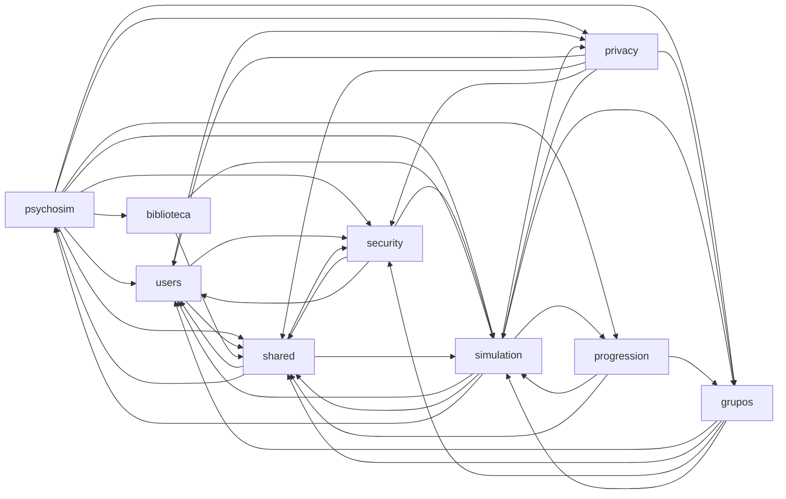
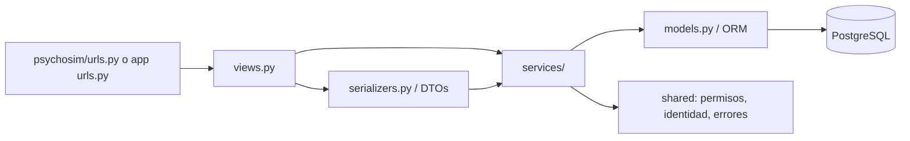

Borrador generado a partir del código; verificar antes de publicar

# Arquitectura del backend (corte S1–S4)

## Alcance

La copia analizada es el código del proyecto original, corte del manifiesto: 290 archivos (137 de producción, 133 de prueba, 18 migraciones y 2 de configuración), todos hallados. La raíz descrita aquí equivale al contenido de `backend_django`; por eso los paths empiezan en `apps/`, `psychosim/` y `shared/`. Conteo extraído por [`extract_backend.py`](./_scripts/extract_backend.py). El archivo `grafo-imports.csv:1` resume imports estáticos; aristas filtradas a archivos del corte.

## Responsabilidades

| Área | Responsabilidad visible | Sprint y evidencia |
|---|---|---|
| `psychosim` | Configuración Django común, configuración por entorno, WSGI y despacho URL raíz. | S1; `psychosim/settings/base.py:4`, `psychosim/urls.py:1` |
| `users` | Usuario propio, autenticación JWT, login, solicitudes de acceso y operaciones de cuenta. | S1; `apps/users/models.py:44`, `apps/users/views.py:137` |
| `shared` | Utilidades transversales para HTTP, seguridad, políticas, identidad, salud y errores. No es una Django app registrada. | S1; `psychosim/settings/base.py:22`, `shared/health.py:18`, `shared/permissions.py:23` |
| `security` | Limitación de frecuencia, reporte CSP y controles asociados. | S1; `apps/security/models.py:10`, `apps/security/csp_report.py:202` |
| `privacy` | Consentimientos, inventario y servicios de derechos de titulares. | S2; `apps/privacy/models.py:27`, `apps/privacy/services.py:151, :361, :441` |
| `grupos` | Grupos, membresías/invitaciones y asignación de casos. | S2–S3 según archivo; `apps/grupos/models.py:12`, el manifiesto del corte |
| `simulation` | Modelos de caso, mundo e intento, ciclo de juego, reglas y evaluación; solo archivos marcados S2–S4. | `apps/simulation/models/case.py:31`, `apps/simulation/services/game_service.py:246, :526, :612`, `apps/simulation/assessment/evaluation.py:57` |
| `progression` | Registro de primera finalización por estudiante y decisiones de acceso/catálogo. | S4; `apps/progression/models.py:11`, `apps/progression/services.py:1` |
| `biblioteca` | Consulta y copia de lugares/escenarios reutilizables para autoría. | S4; `apps/biblioteca/services/lugares.py:60, :101`, `apps/biblioteca/services/copiar_al_caso.py:298` |

## Dependencias entre áreas

Grafo agregado desde `grafo-imports.csv`, restringido a archivos listados en el corte. Las flechas expresan importación observada; no son una arquitectura objetivo. Cada pareja tiene al menos una arista en el CSV filtrado (1560 aristas a nivel archivo; los imports repetidos y referencias de paquete cuentan por separado).

> Es un mapa de imports del backend seleccionado, no una recomendación para el nuevo repo. Hay ciclos y dependencias de sprint futuro; ver [riesgos y plan de ruptura](../romper-ciclo.md). El archivo de URLs raíz importa vistas de áreas posteriores incluso antes de sus `include()`; para un acumulado S1/S2 debe separarse según [settings y URLs por sprint](../settings-urls-por-sprint.md).

## Capas observables

No todas las rutas usan un serializer DRF: algunas reciben `request.data` y delegan validación al servicio. La cadena representa responsabilidades habituales verificadas en users/grupos/simulation, no una regla universal. Referencias: `psychosim/urls.py:67`, `apps/users/views.py:140`, `apps/users/serializers.py:1`, `apps/users/services/account_service.py:112, :194, :209`, `apps/users/models.py:44`.

## Decisiones de diseño comprobables

- **Modelo de usuario explícito:** `CustomUser` hereda `AbstractBaseUser`, declara email como `USERNAME_FIELD`, manager propio y métodos de compatibilidad BCrypt (`apps/users/models.py:44`, `apps/users/models.py:24`).
- **Lógica de cuenta fuera de vistas:** `apps/users/views.py:140` procesa la solicitud HTTP y usa serializador/servicios; operaciones reutilizables como `revoke_sessions` viven en `apps/users/services/account_service.py:112, :194, :209`. Es separación de responsabilidades local, no prueba de cumplimiento completo de SRP.
- **Permisos como política compartida:** vistas llaman `policy_permission(recurso, acción)` y la implementación está en `shared/permissions.py:23`; el default DRF exige autenticación en `psychosim/settings/base.py:138`.
- **Límite compartido persistido:** `RateLimitBucket` usa clave compuesta y hash de clave, para que varios workers no mantengan contadores independientes (`apps/security/models.py:10`).
- **Consenso append-only:** privacidad conserva aceptación y retiro mediante `accepted_at`/`withdrawn_at`, con restricciones de unicidad/check (`apps/privacy/models.py:27`). El módulo privacy documenta evitar FK desde simulation para no crear ese ciclo (`apps/privacy/models.py:1`).
- **Progreso desacoplado por IDs:** `StudentCaseCompletion` guarda IDs como enteros, sin FK a tablas heredadas, y unicidad estudiante/caso (`apps/progression/models.py:11`).
- **SOLID:** los indicios `patrones-solid.md` se usaron como guía, no como evidencia. No se afirma cumplimiento general. La separación vista/servicio anterior sí es demostrable; las funciones extensas listadas en esa nota son candidatos de revisión, no incumplimientos probados.

## Antipatrones/ciclos conocidos

El grafo muestra dependencias bidireccionales `users↔privacy`, `users↔security`, `shared↔psychosim`, `simulation↔grupos`, `simulation↔privacy`, `simulation↔progression` y acoplamiento de `psychosim/urls.py` a vistas de varias apps. El conteo de imports no prueba por sí solo un fallo en tiempo de ejecución. La propuesta para cortar dependencias, las líneas origen y los hitos están en [romper-ciclo.md](../romper-ciclo.md) (propuesta, no aplicada); la estrategia de incluir URLs/migraciones gradualmente está en [settings-urls-por-sprint.md](../settings-urls-por-sprint.md).
