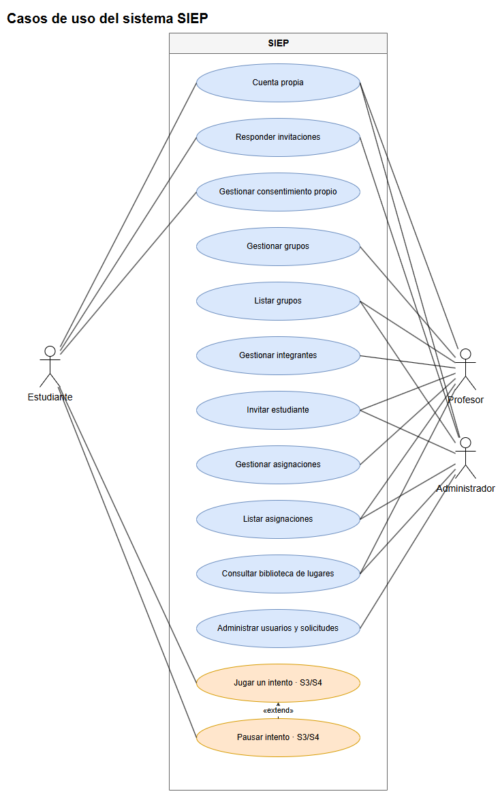

# Descripciones de casos de uso

Rutas relativas a la raíz del backend; líneas de la copia local. Los actores indicados son primarios alternativos cuando aparecen varios; no se identifican actores secundarios externos en estas operaciones. `own` restringe al recurso propio y `all` permite alcance general según `shared/policies.py:1`, `shared/policies.py:35` y `shared/permissions.py:23`. Las precondiciones comunes son autenticación y permiso; las operaciones con datos usan su serializador y los servicios aplican restricciones adicionales. Se especifican solo errores observados; la ausencia de un error en esta tabla no implica que no exista.

| ID | Nombre | Actor primario; secundarios | Precondiciones | Flujo principal | Alternos / errores | Postcondiciones | Justificación de inclusión | Evidencia archivo:línea |
|---|---|---|---|---|---|---|---|---|
| CU1 | Cuenta propia | Estudiante, profesor o administrador; ninguno identificado | Cuenta autenticada, `account.self` | Consultar perfil, cambiar contraseña o cerrar sesión | Datos de contraseña inválidos se rechazan por serializador; cambio de contraseña renueva token y revoca otras sesiones | Perfil consultado, contraseña cambiada o sesiones revocadas | Acciones comunes para mantener la propia cuenta | `apps/users/views.py:318`, `apps/users/views.py:334`, `apps/users/views.py:358`, `shared/policies.py:74` |
| CU2 | Responder invitaciones | Estudiante; administrador para activar membresía; ninguno identificado | `membership.respond`; estudiante sobre sí mismo o administrador | Listar invitaciones y aceptar, rechazar o salir; administrador puede activar | Estado incompatible 409; esquema declara 401, 403 y 404; activación verifica alcance | Membresía queda en el estado devuelto | Permite resolver la pertenencia a grupos | `apps/grupos/views.py:244`, `apps/grupos/views.py:266`, `apps/grupos/views.py:276`, `apps/grupos/views.py:285`, `shared/policies.py:50` |
| CU3 | Gestionar consentimiento propio | Estudiante; ninguno identificado | `consent.read` o `consent.record`; versión alcanzable | Consultar aviso; aceptar versión vigente o retirar | Aceptación repetida 200; nueva 201; aviso obsoleto 409; cuerpo inválido 400; retirada idempotente | Aceptación registrada o retirada; retirar no borra lo hecho | Registra la decisión sobre el aviso de contenido | `apps/privacy/views.py:30`, `apps/privacy/views.py:38`, `apps/privacy/views.py:61`, `apps/privacy/views.py:79`, `shared/policies.py:70` |
| CU4 | Gestionar grupos | Profesor; ninguno identificado | `group.manage`, alcance propio | Validar y crear, actualizar o eliminar grupo | Serializador rechaza datos inválidos; restricciones del servicio no desarrolladas aquí | Grupo creado, actualizado o eliminado | Administra la estructura docente | `apps/grupos/views.py:43`, `apps/grupos/views.py:56`, `apps/grupos/views.py:63`, `shared/policies.py:46` |
| CU5 | Listar grupos | Profesor o administrador; ninguno identificado | `group.list` | Administrador consulta grupos activos; profesor consulta los suyos | Acceso denegado si no se satisface la política | Lista devuelta | Acceso a los grupos según el rol | `apps/grupos/views.py:43`, `apps/grupos/views.py:50`, `shared/policies.py:47` |
| CU6 | Gestionar integrantes | Profesor; ninguno identificado | `group.manage` para grupo propio | Listar estudiantes, retirar o importar integrantes | Importación inválida retorna 400; validación del archivo por serializador | Lista devuelta, integrante retirado o importación procesada | Permite administrar integrantes de grupos | `apps/grupos/views.py:84`, `apps/grupos/views.py:105`, `apps/grupos/views.py:113`, `shared/policies.py:46` |
| CU7 | Invitar estudiante | Profesor o administrador; ninguno identificado | `membership.invite`; profesor con alcance propio | Enviar correo validado para invitación al grupo | Mensaje uniforme exista o no la cuenta; serializador rechaza datos inválidos | Servicio procesa invitación sin revelar existencia de cuenta | Incorpora estudiantes preservando privacidad del correo | `apps/grupos/views.py:84`, `apps/grupos/views.py:94`, `shared/policies.py:49` |
| CU8 | Gestionar asignaciones | Profesor; ninguno identificado | `assignment.manage` sobre sus grupos | Validar y asignar caso; actualizar ventana/orden/pausa o retirar | Serializadores rechazan datos inválidos; restricciones de servicio no desarrolladas aquí | Asignación creada, cambiada o retirada | Vincula casos con grupos y regula disponibilidad | `apps/grupos/views.py:152`, `apps/grupos/views.py:160`, `apps/grupos/views.py:219`, `apps/grupos/views.py:231`, `shared/policies.py:52` |
| CU9 | Listar asignaciones | Profesor o administrador; ninguno identificado | `assignment.list`; alcance propio o general | Consultar asignaciones por grupo o filtros opcionales | Filtro entero inválido produce 400; esquema declara 401, 403 y 404 | Lista de asignaciones devuelta | Permite conocer los casos asignados | `apps/grupos/views.py:152`, `apps/grupos/views.py:176`, `apps/grupos/views.py:196`, `shared/policies.py:53` |
| CU10 | Consultar biblioteca de lugares | Profesor o administrador; ninguno identificado | `case.author` | Listar lugares o consultar uno por ID | Estudiante recibe 403 y sin sesión 401 según documentación de la vista | Representación pública del lugar devuelta | Proporciona lugares para autoría | `apps/biblioteca/views.py:1`, `apps/biblioteca/views.py:14`, `apps/biblioteca/views.py:19`, `apps/biblioteca/views.py:24`, `shared/policies.py:41` |
| CU11 | Administrar usuarios y solicitudes | Administrador; ninguno identificado | `user.manage` | Listar o crear usuarios, aprobar pendientes, listar o cambiar estado de solicitudes | Serializadores validan datos de escritura y estado | Cuenta o solicitud procesada, o lista devuelta | Gestiona acceso y cuentas | `apps/users/views.py:289`, `apps/users/views.py:301`, `apps/users/views.py:346`, `apps/users/views.py:367`, `shared/policies.py:63` |
| CU12 | Jugar un intento · S3/S4 | Estudiante; ninguno identificado | `attempt.play`, caso accesible y versión válida; para órdenes de juego se comprueban dueño, token y consentimiento cuando se exige | Iniciar o recuperar intento abierto; elegir decisiones; al llegar a nodo terminal se completa; puede pausar y reanudar | Sin nodo inicial: no encontrado; `forceNew` en modo estricto con intento abierto: 409; decisión inexistente o no disponible: error; repetición por identificador puede devolver respuesta previa | Se devuelve el estado y, al llegar al terminal, intento completado | Representa el flujo central del simulador, ausente en la versión anterior | `apps/simulation/urls.py:38`, `apps/simulation/urls.py:47`, `apps/simulation/views/game_views.py:73`, `apps/simulation/views/game_views.py:214`, `apps/simulation/services/game_service.py:107`, `apps/simulation/services/game_service.py:246`, `apps/simulation/services/game_service.py:526`, `apps/simulation/services/game_service.py:591` |
| CU13 | Pausar intento · S3/S4 | Estudiante; ninguno identificado | `attempt.play`, intento propio y token | Solicitar salida segura; servicio registra pausa | Si no puede aplicar pausa devuelve estado sin duplicar; no exige consentimiento ni asignación para esta salida | Intento en pausa reanudable cuando se aplica | Alternativa opcional durante el juego, representada como «extend» | `apps/simulation/urls.py:57`, `apps/simulation/views/game_views.py:244`, `apps/simulation/services/game_service.py:655`, `shared/policies.py:35` |

## Sin verificar

No se ejecutaron las rutas ni se revisaron exhaustivamente todos los errores de servicios y serializadores. No se verificó que esta copia coincida con el proyecto original. Las condiciones de consentimiento no se generalizan a inicio, pausa o reanudación: estas operaciones tienen excepciones específicas (`apps/simulation/services/game_service.py:246`, `:655`, `:676`).

