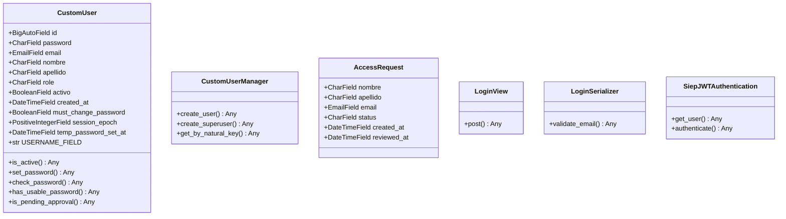
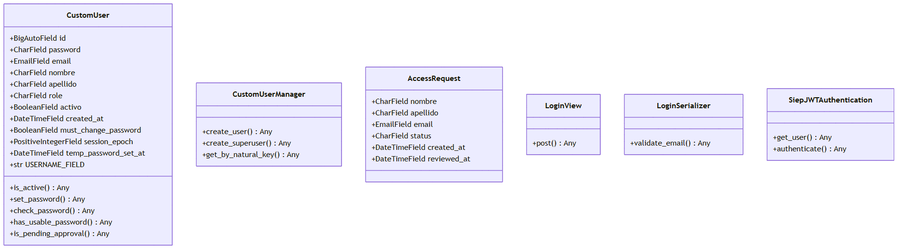

# Clases A

Selección de clases del corte. Tipos de campo son clases Django declaradas; `Any` indica que el código no anota el tipo. Asociaciones muestran extremos ORM; no se infiere composición por cascada.

Ver como imagen (respaldo si GitHub no dibuja el diagrama)

## Omisiones

Se omiten el resto de vistas, serializers, validadores y comandos de users; psychosim contiene configuración y funciones, no clases declaradas en archivos incluidos.

## Evidencia

- `apps/users/models.py:44` — CustomUser y bases.
- `apps/users/models.py:45` — CustomUser.id.
- `apps/users/models.py:47` — CustomUser.password.
- `apps/users/models.py:51` — CustomUser.email.
- `apps/users/models.py:52` — CustomUser.nombre.
- `apps/users/models.py:53` — CustomUser.apellido.
- `apps/users/models.py:54` — CustomUser.role.
- `apps/users/models.py:57` — CustomUser.activo.
- `apps/users/models.py:58` — CustomUser.created_at.
- `apps/users/models.py:61` — CustomUser.must_change_password.
- `apps/users/models.py:64` — CustomUser.session_epoch.
- `apps/users/models.py:67` — CustomUser.temp_password_set_at.
- `apps/users/models.py:69` — CustomUser.USERNAME_FIELD.
- `apps/users/models.py:85` — CustomUser.is_active.
- `apps/users/models.py:92` — CustomUser.set_password.
- `apps/users/models.py:102` — CustomUser.check_password.
- `apps/users/models.py:115` — CustomUser.has_usable_password.
- `apps/users/models.py:119` — CustomUser.is_pending_approval.
- `apps/users/models.py:27` — CustomUserManager y bases.
- `apps/users/models.py:28` — CustomUserManager.create_user.
- `apps/users/models.py:36` — CustomUserManager.create_superuser.
- `apps/users/models.py:40` — CustomUserManager.get_by_natural_key.
- `apps/users/models.py:150` — AccessRequest y bases.
- `apps/users/models.py:151` — AccessRequest.nombre.
- `apps/users/models.py:152` — AccessRequest.apellido.
- `apps/users/models.py:153` — AccessRequest.email.
- `apps/users/models.py:154` — AccessRequest.status.
- `apps/users/models.py:159` — AccessRequest.created_at.
- `apps/users/models.py:160` — AccessRequest.reviewed_at.
- `apps/users/views.py:134` — LoginView y bases.
- `apps/users/views.py:140` — LoginView.post.
- `apps/users/serializers.py:179` — LoginSerializer y bases.
- `apps/users/serializers.py:184` — LoginSerializer.validate_email.
- `apps/users/authentication.py:29` — SiepJWTAuthentication y bases.
- `apps/users/authentication.py:30` — SiepJWTAuthentication.get_user.
- `apps/users/authentication.py:38` — SiepJWTAuthentication.authenticate.

## Sin verificar

- Interpretación UML, elección de clases y visualización por el responsable.
- Resultados de pruebas y funcionamiento del corte integrado.
