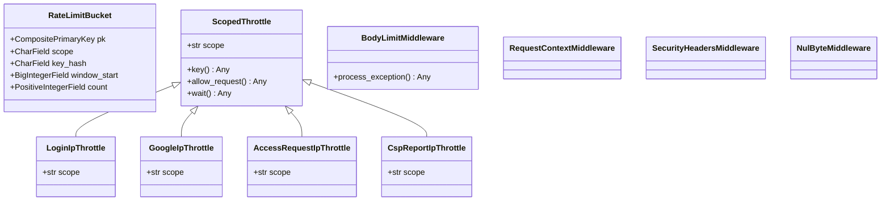
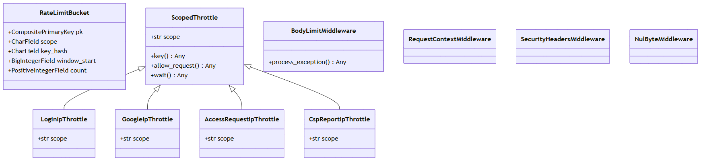

# Clases B

Selección de clases del corte. Tipos de campo son clases Django declaradas; `Any` indica que el código no anota el tipo. Asociaciones muestran extremos ORM; no se infiere composición por cascada.

Ver como imagen (respaldo si GitHub no dibuja el diagrama)

## Omisiones

Se omiten parsers, clases de permisos, otros throttles y utilidades para mantener el diagrama legible.

## Evidencia

- `apps/security/models.py:10` — RateLimitBucket y bases.
- `apps/security/models.py:11` — RateLimitBucket.pk.
- `apps/security/models.py:12` — RateLimitBucket.scope.
- `apps/security/models.py:13` — RateLimitBucket.key_hash.
- `apps/security/models.py:15` — RateLimitBucket.window_start.
- `apps/security/models.py:16` — RateLimitBucket.count.
- `apps/security/throttling.py:16` — ScopedThrottle y bases.
- `apps/security/throttling.py:17` — ScopedThrottle.scope.
- `apps/security/throttling.py:21` — ScopedThrottle.key.
- `apps/security/throttling.py:25` — ScopedThrottle.allow_request.
- `apps/security/throttling.py:36` — ScopedThrottle.wait.
- `apps/security/throttling.py:40` — LoginIpThrottle y bases.
- `apps/security/throttling.py:41` — LoginIpThrottle.scope.
- `apps/security/throttling.py:45` — GoogleIpThrottle y bases.
- `apps/security/throttling.py:46` — GoogleIpThrottle.scope.
- `apps/security/throttling.py:50` — AccessRequestIpThrottle y bases.
- `apps/security/throttling.py:51` — AccessRequestIpThrottle.scope.
- `apps/security/throttling.py:55` — CspReportIpThrottle y bases.
- `apps/security/throttling.py:59` — CspReportIpThrottle.scope.
- `shared/body_limit.py:123` — BodyLimitMiddleware y bases.
- `shared/body_limit.py:147` — BodyLimitMiddleware.process_exception.
- `shared/middleware.py:13` — RequestContextMiddleware y bases.
- `shared/security_headers.py:27` — SecurityHeadersMiddleware y bases.
- `shared/text_guard.py:60` — NulByteMiddleware y bases.

## Sin verificar

- Interpretación UML, elección de clases y visualización por el responsable.
- Resultados de pruebas y funcionamiento del corte integrado.
