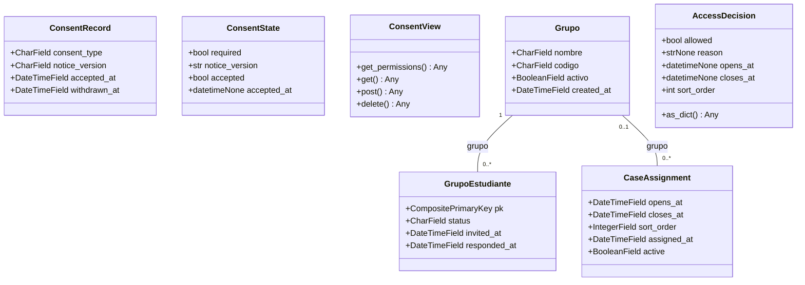
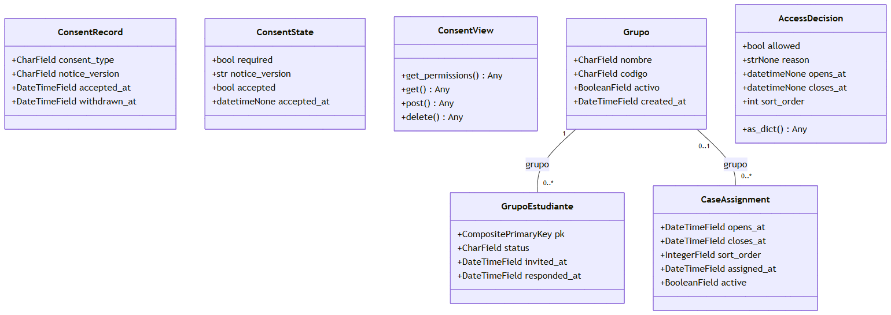

# Clases C

Selección de clases del corte. Tipos de campo son clases Django declaradas; `Any` indica que el código no anota el tipo. Asociaciones muestran extremos ORM; no se infiere composición por cascada.

Ver como imagen (respaldo si GitHub no dibuja el diagrama)

## Omisiones

Se omiten contratos, serializers y vistas adicionales; CustomUser y CaseVersion se representan en dominio.md para evitar duplicación.

## Evidencia

- `apps/privacy/models.py:27` — ConsentRecord y bases.
- `apps/privacy/models.py:31` — ConsentRecord.consent_type.
- `apps/privacy/models.py:41` — ConsentRecord.notice_version.
- `apps/privacy/models.py:42` — ConsentRecord.accepted_at.
- `apps/privacy/models.py:43` — ConsentRecord.withdrawn_at.
- `apps/privacy/consent_service.py:46` — ConsentState y bases.
- `apps/privacy/consent_service.py:49` — ConsentState.required.
- `apps/privacy/consent_service.py:50` — ConsentState.notice_version.
- `apps/privacy/consent_service.py:51` — ConsentState.accepted.
- `apps/privacy/consent_service.py:52` — ConsentState.accepted_at.
- `apps/privacy/views.py:30` — ConsentView y bases.
- `apps/privacy/views.py:33` — ConsentView.get_permissions.
- `apps/privacy/views.py:38` — ConsentView.get.
- `apps/privacy/views.py:61` — ConsentView.post.
- `apps/privacy/views.py:79` — ConsentView.delete.
- `apps/grupos/models.py:12` — Grupo y bases.
- `apps/grupos/models.py:13` — Grupo.nombre.
- `apps/grupos/models.py:14` — Grupo.codigo.
- `apps/grupos/models.py:21` — Grupo.activo.
- `apps/grupos/models.py:22` — Grupo.created_at.
- `apps/grupos/models.py:40` — GrupoEstudiante y bases.
- `apps/grupos/models.py:41` — GrupoEstudiante.pk.
- `apps/grupos/models.py:49` — GrupoEstudiante.status.
- `apps/grupos/models.py:57` — GrupoEstudiante.invited_at.
- `apps/grupos/models.py:58` — GrupoEstudiante.responded_at.
- `apps/grupos/models.py:73` — CaseAssignment y bases.
- `apps/grupos/models.py:95` — CaseAssignment.opens_at.
- `apps/grupos/models.py:96` — CaseAssignment.closes_at.
- `apps/grupos/models.py:97` — CaseAssignment.sort_order.
- `apps/grupos/models.py:102` — CaseAssignment.assigned_at.
- `apps/grupos/models.py:103` — CaseAssignment.active.
- `apps/grupos/access.py:28` — AccessDecision y bases.
- `apps/grupos/access.py:36` — AccessDecision.allowed.
- `apps/grupos/access.py:37` — AccessDecision.reason.
- `apps/grupos/access.py:38` — AccessDecision.opens_at.
- `apps/grupos/access.py:39` — AccessDecision.closes_at.
- `apps/grupos/access.py:40` — AccessDecision.sort_order.
- `apps/grupos/access.py:42` — AccessDecision.as_dict.

## Sin verificar

- Interpretación UML, elección de clases y visualización por el responsable.
- Resultados de pruebas y funcionamiento del corte integrado.
