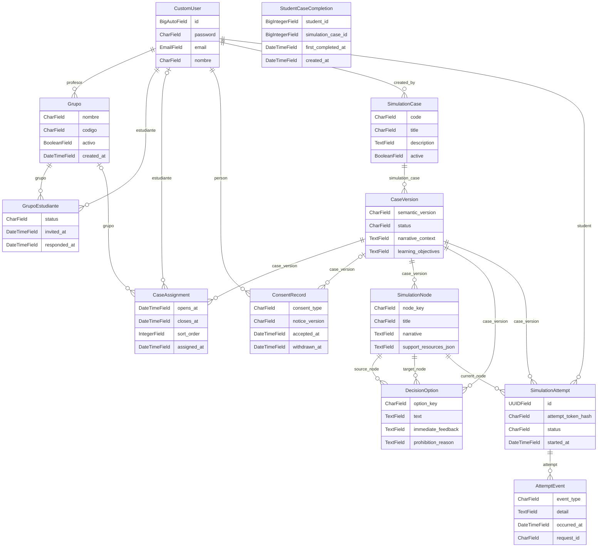
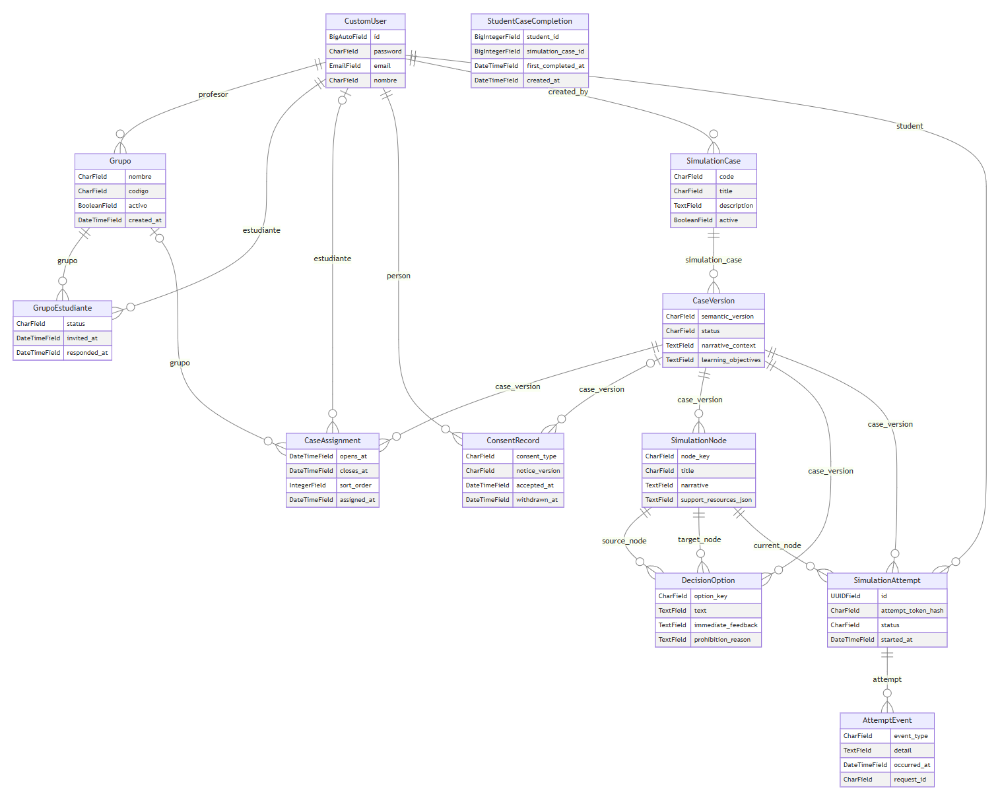

# Dominio del corte

Cardinalidades desde campos ORM: una FK no nula apunta a una entidad; `null=True` permite cero o una. La unicidad adicional y las restricciones de negocio no se reducen a estas líneas. StudentCaseCompletion almacena identificadores sin FK; por eso no se dibujan relaciones físicas.

Ver como imagen (respaldo si GitHub no dibuja el diagrama)

## Glosario

- **CustomUser**: Cuenta de usuario.
- **Grupo**: Grupo de un profesor.
- **GrupoEstudiante**: Membresía e invitación de estudiante al grupo.
- **CaseAssignment**: Asignación de versión de caso a grupo o estudiante.
- **ConsentRecord**: Registro de consentimiento de una persona.
- **SimulationCase**: Caso de simulación.
- **CaseVersion**: Versión de un caso.
- **SimulationNode**: Nodo narrativo de una versión.
- **DecisionOption**: Opción de decisión entre nodos.
- **SimulationAttempt**: Intento de un estudiante sobre una versión.
- **AttemptEvent**: Evento registrado durante un intento.
- **StudentCaseCompletion**: Primera finalización de un caso por un estudiante.

## Evidencia

- `apps/grupos/models.py:15` — Grupo.profesor, relación y nulabilidad.
- `apps/grupos/models.py:42` — GrupoEstudiante.grupo, relación y nulabilidad.
- `apps/grupos/models.py:43` — GrupoEstudiante.estudiante, relación y nulabilidad.
- `apps/grupos/models.py:87` — CaseAssignment.grupo, relación y nulabilidad.
- `apps/grupos/models.py:91` — CaseAssignment.estudiante, relación y nulabilidad.
- `apps/grupos/models.py:83` — CaseAssignment.case_version, relación y nulabilidad.
- `apps/privacy/models.py:28` — ConsentRecord.person, relación y nulabilidad.
- `apps/privacy/models.py:36` — ConsentRecord.case_version, relación y nulabilidad.
- `apps/simulation/models/case.py:36` — SimulationCase.created_by, relación y nulabilidad.
- `apps/simulation/models/case.py:51` — CaseVersion.simulation_case, relación y nulabilidad.
- `apps/simulation/models/case.py:182` — SimulationNode.case_version, relación y nulabilidad.
- `apps/simulation/models/case.py:223` — DecisionOption.case_version, relación y nulabilidad.
- `apps/simulation/models/case.py:227` — DecisionOption.source_node, relación y nulabilidad.
- `apps/simulation/models/case.py:230` — DecisionOption.target_node, relación y nulabilidad.
- `apps/simulation/models/attempt.py:49` — SimulationAttempt.case_version, relación y nulabilidad.
- `apps/simulation/models/attempt.py:52` — SimulationAttempt.student, relación y nulabilidad.
- `apps/simulation/models/attempt.py:55` — SimulationAttempt.current_node, relación y nulabilidad.
- `apps/simulation/models/attempt.py:95` — AttemptEvent.attempt, relación y nulabilidad.
- `apps/users/models.py:45` — CustomUser.id.
- `apps/users/models.py:47` — CustomUser.password.
- `apps/users/models.py:51` — CustomUser.email.
- `apps/users/models.py:52` — CustomUser.nombre.
- `apps/users/models.py:44` — entidad CustomUser.
- `apps/grupos/models.py:13` — Grupo.nombre.
- `apps/grupos/models.py:14` — Grupo.codigo.
- `apps/grupos/models.py:21` — Grupo.activo.
- `apps/grupos/models.py:22` — Grupo.created_at.
- `apps/grupos/models.py:12` — entidad Grupo.
- `apps/grupos/models.py:49` — GrupoEstudiante.status.
- `apps/grupos/models.py:57` — GrupoEstudiante.invited_at.
- `apps/grupos/models.py:58` — GrupoEstudiante.responded_at.
- `apps/grupos/models.py:40` — entidad GrupoEstudiante.
- `apps/grupos/models.py:95` — CaseAssignment.opens_at.
- `apps/grupos/models.py:96` — CaseAssignment.closes_at.
- `apps/grupos/models.py:97` — CaseAssignment.sort_order.
- `apps/grupos/models.py:102` — CaseAssignment.assigned_at.
- `apps/grupos/models.py:73` — entidad CaseAssignment.
- `apps/privacy/models.py:31` — ConsentRecord.consent_type.
- `apps/privacy/models.py:41` — ConsentRecord.notice_version.
- `apps/privacy/models.py:42` — ConsentRecord.accepted_at.
- `apps/privacy/models.py:43` — ConsentRecord.withdrawn_at.
- `apps/privacy/models.py:27` — entidad ConsentRecord.
- `apps/simulation/models/case.py:32` — SimulationCase.code.
- `apps/simulation/models/case.py:33` — SimulationCase.title.
- `apps/simulation/models/case.py:34` — SimulationCase.description.
- `apps/simulation/models/case.py:35` — SimulationCase.active.
- `apps/simulation/models/case.py:31` — entidad SimulationCase.
- `apps/simulation/models/case.py:55` — CaseVersion.semantic_version.
- `apps/simulation/models/case.py:56` — CaseVersion.status.
- `apps/simulation/models/case.py:59` — CaseVersion.narrative_context.
- `apps/simulation/models/case.py:62` — CaseVersion.learning_objectives.
- `apps/simulation/models/case.py:50` — entidad CaseVersion.
- `apps/simulation/models/case.py:185` — SimulationNode.node_key.
- `apps/simulation/models/case.py:186` — SimulationNode.title.
- `apps/simulation/models/case.py:187` — SimulationNode.narrative.
- `apps/simulation/models/case.py:188` — SimulationNode.support_resources_json.
- `apps/simulation/models/case.py:181` — entidad SimulationNode.
- `apps/simulation/models/case.py:226` — DecisionOption.option_key.
- `apps/simulation/models/case.py:234` — DecisionOption.text.
- `apps/simulation/models/case.py:235` — DecisionOption.immediate_feedback.
- `apps/simulation/models/case.py:236` — DecisionOption.prohibition_reason.
- `apps/simulation/models/case.py:222` — entidad DecisionOption.
- `apps/simulation/models/attempt.py:47` — SimulationAttempt.id.
- `apps/simulation/models/attempt.py:48` — SimulationAttempt.attempt_token_hash.
- `apps/simulation/models/attempt.py:58` — SimulationAttempt.status.
- `apps/simulation/models/attempt.py:61` — SimulationAttempt.started_at.
- `apps/simulation/models/attempt.py:44` — entidad SimulationAttempt.
- `apps/simulation/models/attempt.py:98` — AttemptEvent.event_type.
- `apps/simulation/models/attempt.py:106` — AttemptEvent.detail.
- `apps/simulation/models/attempt.py:107` — AttemptEvent.occurred_at.
- `apps/simulation/models/attempt.py:110` — AttemptEvent.request_id.
- `apps/simulation/models/attempt.py:94` — entidad AttemptEvent.
- `apps/progression/models.py:12` — StudentCaseCompletion.student_id.
- `apps/progression/models.py:13` — StudentCaseCompletion.simulation_case_id.
- `apps/progression/models.py:14` — StudentCaseCompletion.first_completed_at.
- `apps/progression/models.py:15` — StudentCaseCompletion.created_at.
- `apps/progression/models.py:11` — entidad StudentCaseCompletion.

## Sin verificar

- Revisión de cardinalidades, constraints y glosario por responsables del dominio.
- Integración del esquema y migraciones del corte; no se ejecutaron.
