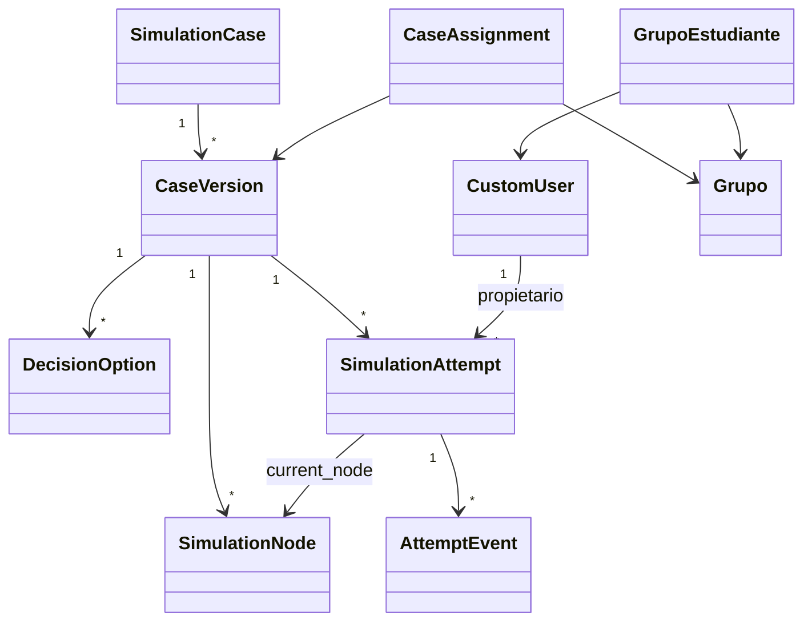
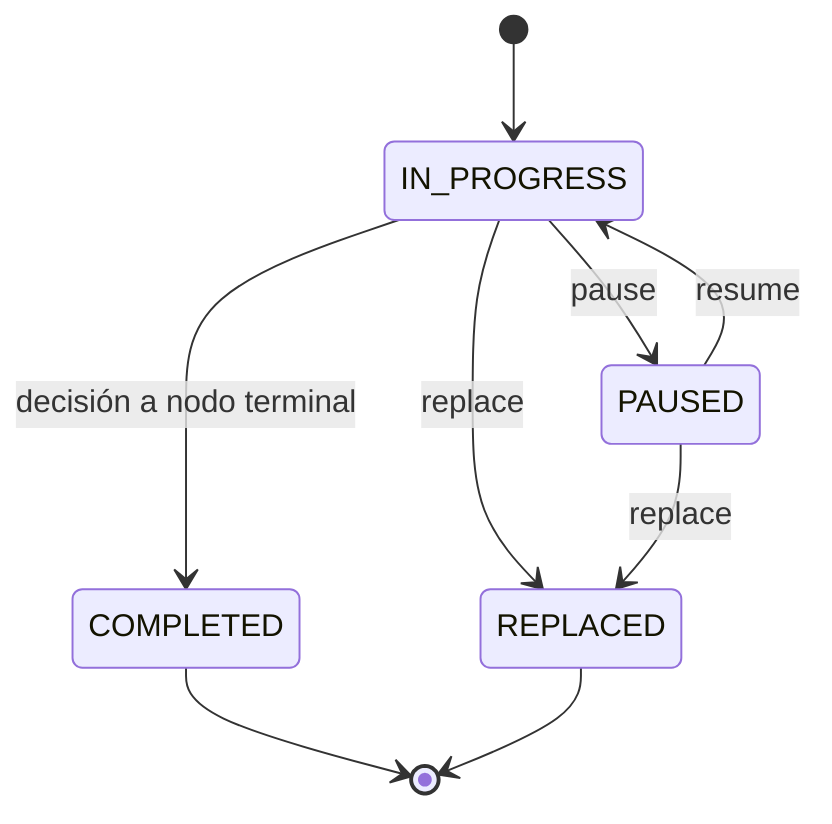
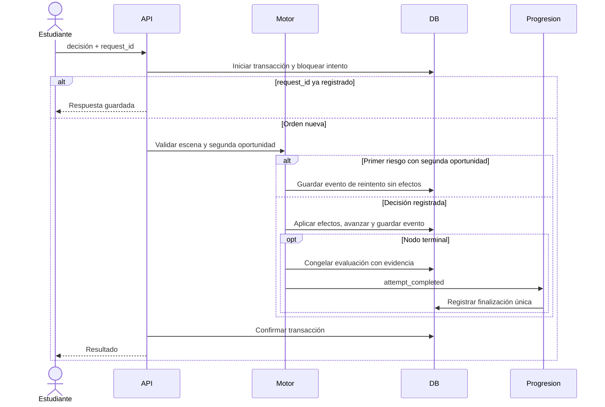

# Diagramas del corte realmente implementado



```mermaid
sequenceDiagram
  actor Estudiante
  participant API
  participant Access
  participant DB
  Estudiante->>API: POST /api/attempts {case_version_id}
  API->>DB: Iniciar transacción y bloquear usuario
  API->>Access: Publicación, sello y asignación vigente
  Access->>DB: Consultar membresía y ventana
  alt Sin acceso
    API-->>Estudiante: 404
  else Con acceso
    API->>DB: Buscar intento abierto
    alt Ya existe
      API-->>Estudiante: 200 intento existente
    else Nuevo
      API->>DB: Crear intento y evento; confirmar
      API-->>Estudiante: 201 intento nuevo
    end
  end
```



SAFE_EXITED solo se conserva como estado histórico; ninguna orden nueva lo genera.

## Decisión, evaluación y progresión S4



Si falla un suscriptor, toda la transacción se revierte. Biblioteca solo lee el catálogo JSON externo; no participa en la transacción de decisiones.
