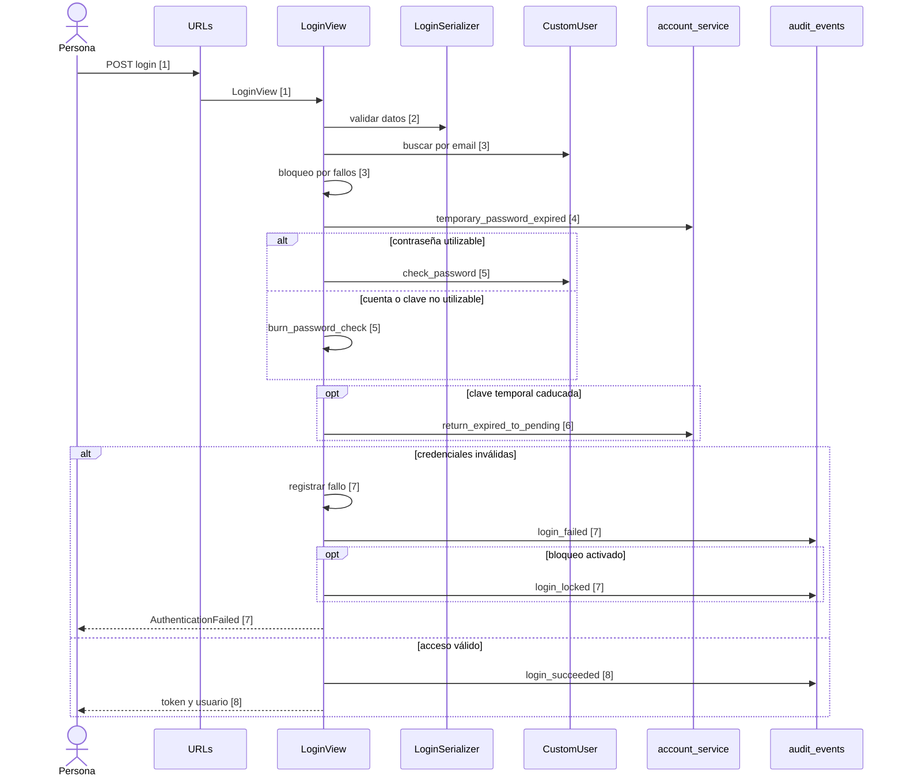
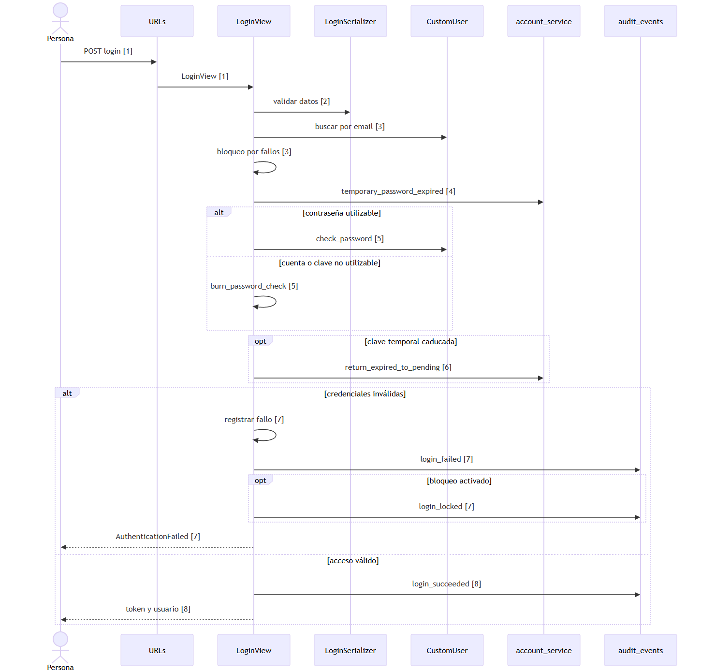

# Inicio de sesión

Las flechas de despacho HTTP resumen la configuración de rutas y el código de las vistas; el framework es externo al corte.

Ver como imagen (respaldo si GitHub no dibuja el diagrama)

## Evidencia

1. `psychosim/urls.py:70`, `apps/users/urls.py:13` — ruta y vista.
2. `apps/users/views.py:140`, `apps/users/serializers.py:179` — validación.
3. `apps/users/views.py:145`, `apps/users/views.py:148`, `apps/users/views.py:149` — búsqueda y bloqueo.
4. `apps/users/views.py:153` — expiración.
5. `apps/users/views.py:156`, `apps/users/views.py:159`, `apps/users/models.py:102` — comprobación.
6. `apps/users/views.py:161` — clave caducada.
7. `apps/users/views.py:164`, `apps/users/views.py:165`, `apps/users/views.py:167`, `apps/users/views.py:169`, `apps/users/views.py:171` — fallo.
8. `apps/users/views.py:173`, `apps/users/views.py:174` — éxito.

## Sin verificar

- Revisión del orden y ejecución real del flujo por el responsable.
- Resultado de pruebas y composición incremental del corte.
