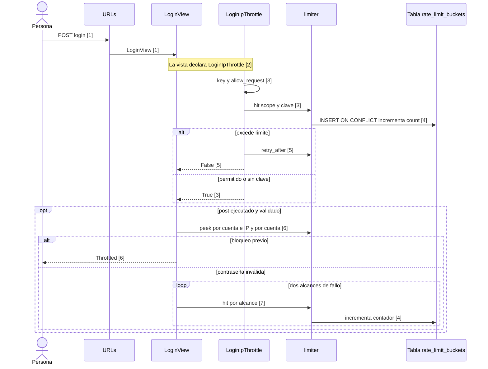
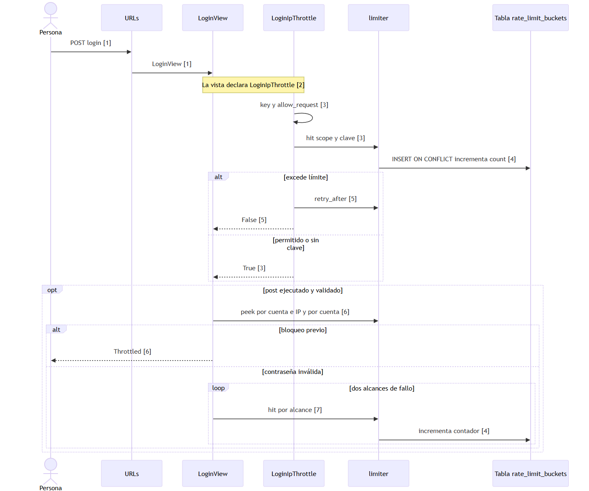

# Límite de uso en login

Las flechas de despacho HTTP resumen la configuración de rutas y el código de las vistas; el framework es externo al corte.

Ver como imagen (respaldo si GitHub no dibuja el diagrama)

## Evidencia

1. `psychosim/urls.py:70`, `apps/users/urls.py:13` — ruta.
2. `apps/users/views.py:134`, `apps/users/views.py:138` — throttle declarado.
3. `apps/security/throttling.py:21`, `apps/security/throttling.py:25`, `apps/security/throttling.py:31`, `apps/security/throttling.py:40` — clave y admisión.
4. `apps/security/limiter.py:59`, `apps/security/limiter.py:65` — SQL; tabla del modelo `apps/security/models.py:10`.
5. `apps/security/throttling.py:31`, `apps/security/throttling.py:33` — espera y rechazo.
6. `apps/users/views.py:92`, `apps/users/views.py:100`, `apps/users/views.py:102`, `apps/users/views.py:107`, `apps/users/views.py:149` — bloqueo.
7. `apps/users/views.py:110`, `apps/users/views.py:117`, `apps/users/views.py:118`, `apps/users/views.py:165` — contador de fallos.

## Sin verificar

- Revisión del orden y ejecución real del flujo por el responsable.
- Resultado de pruebas y composición incremental del corte.
