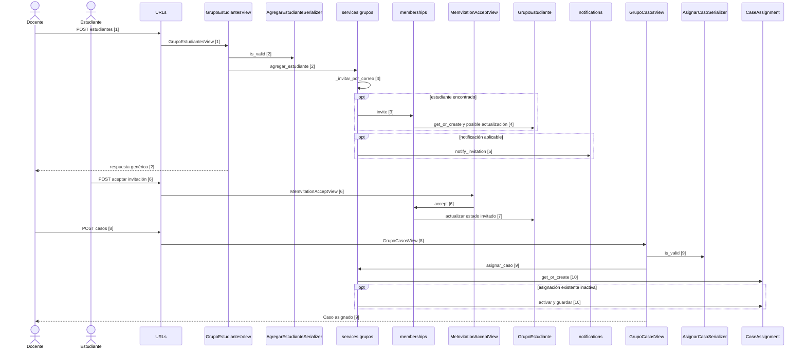
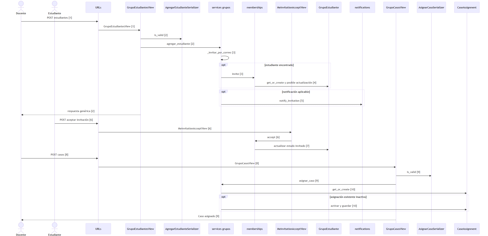

# Invitar y asignar

Las flechas de despacho HTTP resumen la configuración de rutas y el código de las vistas; el framework es externo al corte.

Ver como imagen (respaldo si GitHub no dibuja el diagrama)

## Evidencia

1. `psychosim/urls.py:75`, `apps/grupos/views.py:84` — ruta y vista.
2. `apps/grupos/views.py:94`, `apps/grupos/views.py:95`, `apps/grupos/views.py:97`, `apps/grupos/views.py:100` — validación y respuesta.
3. `apps/grupos/services.py:783`, `apps/grupos/services.py:790`, `apps/grupos/services.py:795` — búsqueda e invitación.
4. `apps/grupos/memberships.py:61`, `apps/grupos/memberships.py:74`, `apps/grupos/memberships.py:80` — persistencia.
5. `apps/grupos/services.py:798`, `apps/grupos/services.py:800` — notificación condicional.
6. `psychosim/urls.py:80`, `apps/grupos/views.py:276`, `apps/grupos/views.py:281` — aceptación.
7. `apps/grupos/memberships.py:127`, `apps/grupos/memberships.py:102`, `apps/grupos/memberships.py:106` — respuesta.
8. `psychosim/urls.py:89`, `apps/grupos/views.py:152` — ruta de asignación heredada.
9. `apps/grupos/views.py:160`, `apps/grupos/views.py:161`, `apps/grupos/views.py:164` — validación y asignación.
10. `apps/grupos/services.py:812`, `apps/grupos/services.py:823`, `apps/grupos/services.py:826` — persistencia.

## Sin verificar

- Revisión del orden y ejecución real del flujo por el responsable.
- Resultado de pruebas y composición incremental del corte.
